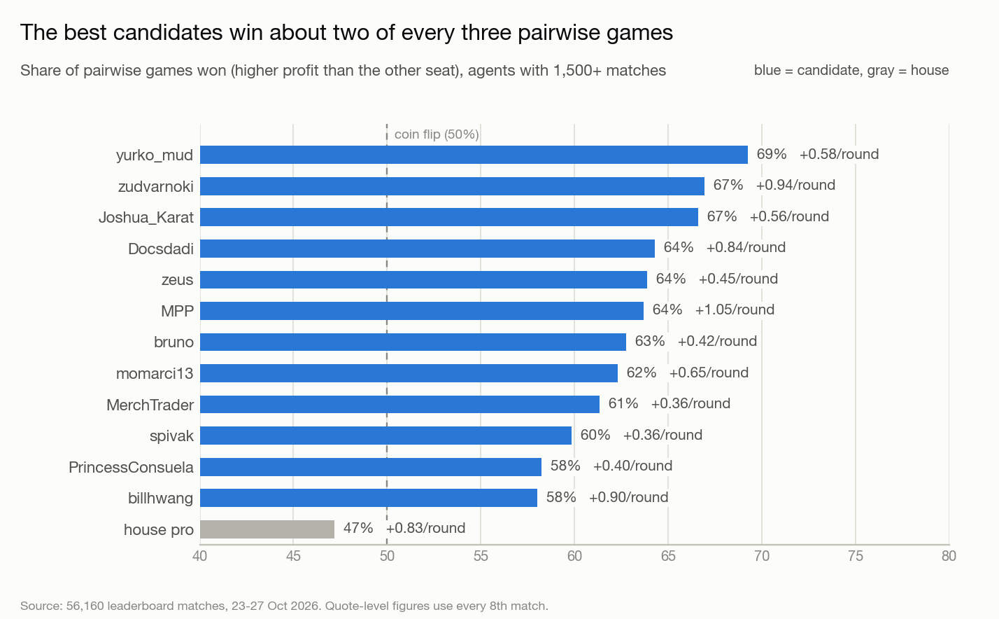
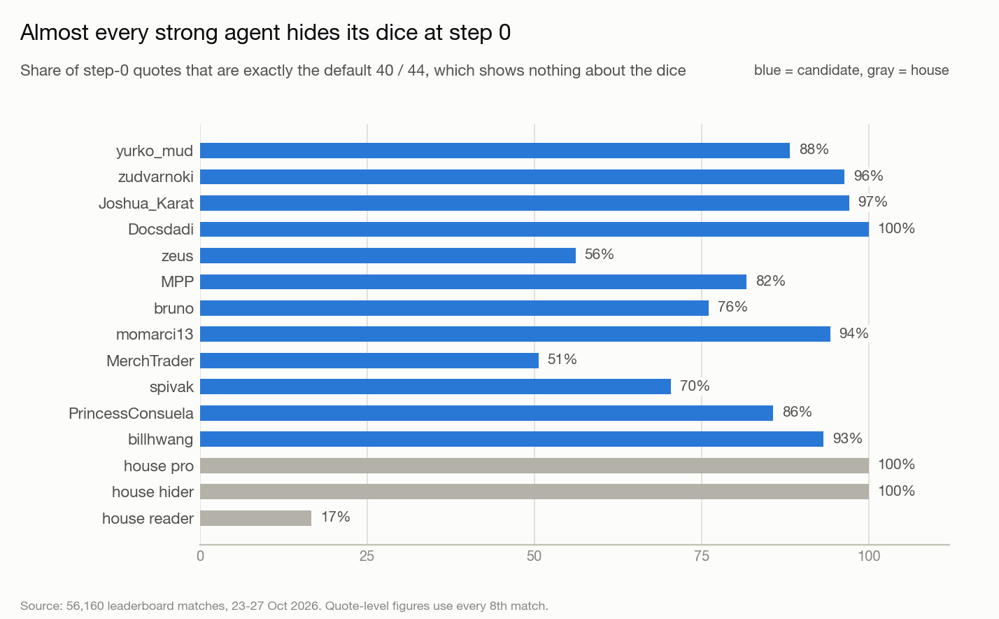
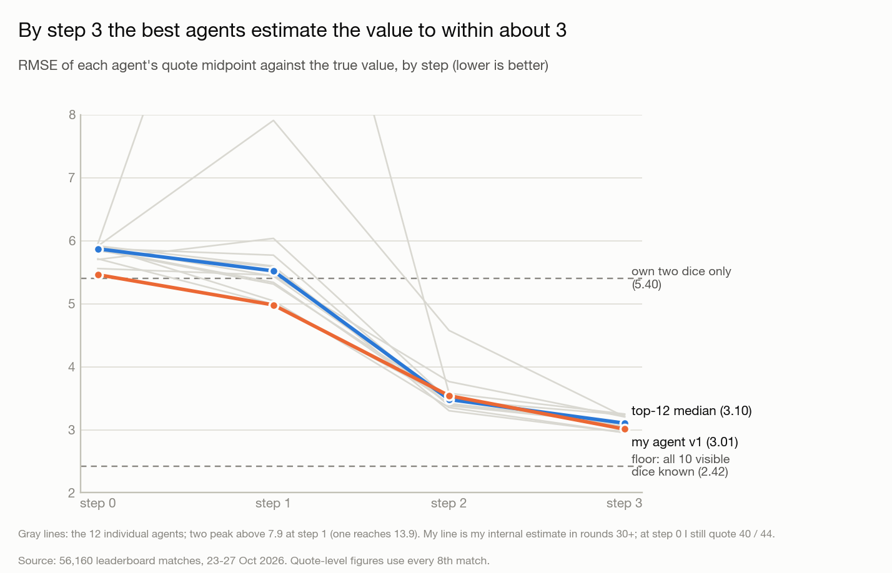
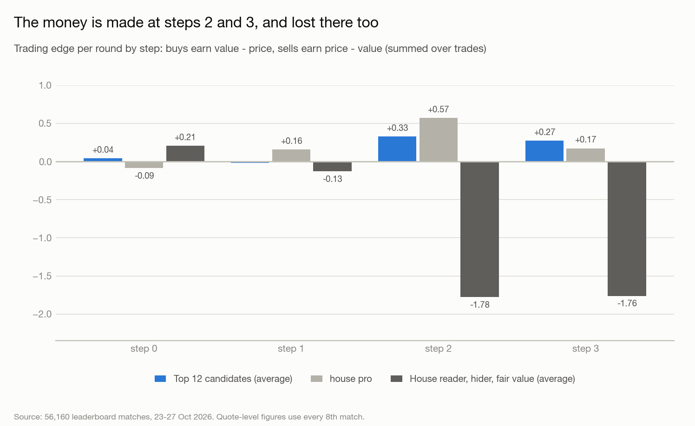
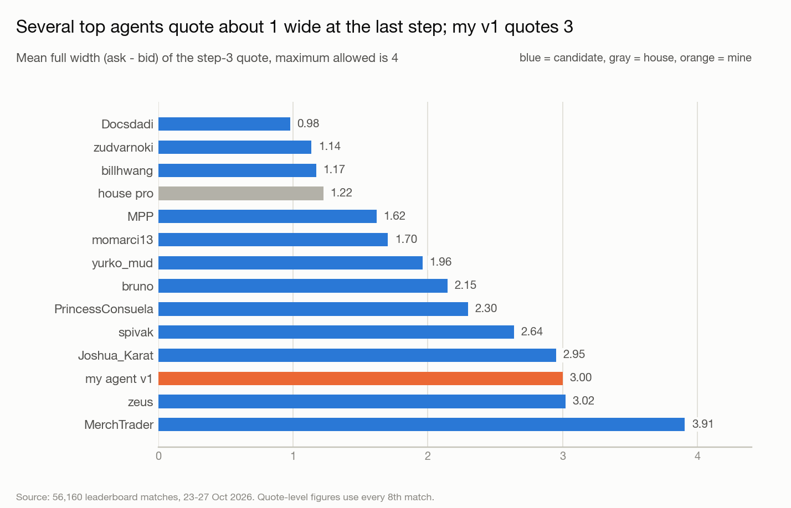
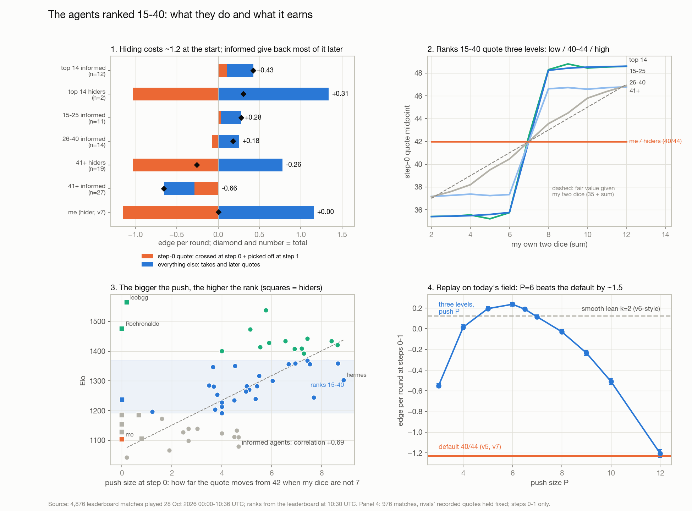

# Dice Market Making: findings, status and ideas

Working notes for the Everesteer dice market making challenge. Last updated 28 Oct 2026. The challenge closes
**1 Nov 2026, 00:00 London time**. Version v5 was uploaded on 27 Oct 2026 and is on the leaderboard (see section 1).

## 1. Status

| Item | State |
|---|---|
| `dice_market/agent.py` (v1, adaptive reader) | Written, passes `--check`, 0 errors and 0 timeouts over a full 200-round match |
| Upload to the leaderboard | **Done 27 Oct 2026** as "adaptive reader v5" (version id 24f4d3). Passed the boss gate 3 of 3 (+5.75 / +4.09 / +4.55 per round vs the boss +3.20 / +0.77 / +1.99). Elo not shown until it has played matches |
| Replay dataset | Downloaded locally (771 MB, not in git). 56,160 matches |
| Real-field strength of v1 | **Unknown.** Local tests only cover the house agents, which are much weaker than real candidates |

## 2. The game in brief (full rules: `dice_market/AGENTS.md`)

- 12 dice are rolled each round, the value is their sum (mean 42, sd 5.9). Seat `i` sees dice `i` and `i+6`. With 5 seats nobody sees dice 5 and 11.
- 4 quoting steps per round. Every seat sends a bid and an ask for 1 unit, at most 4 apart. Quotes rest and can be hit at their own price at the next step (a stale quote). A forced quote is 40 / 44.
- A match is 200 rounds, 5 seats, zero-sum. Elo is based on pairwise profit comparisons (10 games per match), so rank at the table matters, not the size of the profit.
- Pass gate: beat "the boss" in 2 of 3 matches with no errors or slow calls (0.05 s per call).

Corrections to what I first assumed:

- **A position of +5 can never be reached.** A seat has one bid slot, and its old bid can only be hit if the previous step's new bid did not fill. That caps buys at 4 per round (3 old-bid hits plus one new-bid fill at the last step). Confirmed by 300,000 random aggressive rounds (max 4) and a scripted round that reaches +4. The limit of 5 never binds.
- After step 0 every seat re-quotes every step, so cross trades are always at the midpoint. The only trades at a stale price are takes.
- `round_no` is documented as 0..99 in the interface section, but a match is 200 rounds.

## 3. The data

`replays.jsonl.gz` holds every leaderboard match, 23 Oct to 27 Oct 2026 (56,160 matches, 130 agent names; about 238k candidate seats, 42k house seats). It includes **"house pro"**, which the starter pack does not. Download with `dmapi.py dataset`. Files used for analysis live in `dice_market/analysis/`. The summary used by the charts is `docs/data/profile.json`.

Caveats: quote-level statistics come from every 8th match; agent names are account handles, not versions, so one name can mix several uploaded versions.

## 4. What the top agents do



The best candidates win about 2 of 3 pairwise games, on only +0.4 to +1.05 per round. These margins are small, so a 200-round match is noisy and ranking needs many matches.



**Nearly everyone hid at step 0 (23-26 Oct)** by sending exactly the forced quote 40 / 44. **This reversed on 27 Oct**: the share of default quotes fell from 95% (24 Oct) to 37% by midday on the 27th, see section 9. Exceptions: zeus (56%), MerchTrader (51%), spivak (70%). The house reader shows its dice at step 0 in 83% of rounds and loses badly.



The information flow is: step 0 shows nothing, step 1 is where the field first shows its dice, step 2 quotes converge to a consensus, step 3 is the best estimate. By step 3 the best agents' quote mid is within about 3.0 to 3.1 RMSE of the true value. The floor with all ten visible dice known is 2.42. The quotes of the whole field shrink toward 42, so strong rounds are underestimated.



Profit comes from **taking stale quotes at steps 2 and 3**. The house reader, hider and fair value agents lose about 1.8 per round at each of those steps because the field picks them off. Step 0 and step 1 carry almost no edge.



Final-step spreads vary a lot. Docsdadi, zudvarnoki and billhwang quote about 1 wide. yurko_mud (highest win rate) quotes 2.0 and Joshua_Karat 2.95. **The correlation between a tight final spread and win rate across 38 candidates is only -0.19**, so tightening is not clearly the driver. Treat it as something to test.

## 5. How the decode works (and what did not)

All numbers are RMSE of an estimate of the value, from my dice plus the others' quotes.

| Approach | Step 2 | Step 3 |
|---|---|---|
| Own two dice only | 5.40 | 5.40 |
| Pooled linear decode over everyone's mids (offline OLS on 14,000 matches) | 4.33 | 3.28 |
| Other feature sets (sorted mids, abs values) | 4.29 | 3.26 |
| Weighting by each agent's identity (oracle) | n/a | 3.19 |
| Per-agent structural decode of their dice from their step-1 mid (oracle) | 4.47 | n/a |
| **Online per-match ridge regression (agent v1), rounds 30+** | **3.54** | **3.01** |
| Best agents' own quotes | 3.3 to 3.5 | 2.95 to 3.1 |

Conclusions:

- **What matters is adapting within the match.** A fixed pooled decode stalls at about 3.26. Online learning from the revealed true values reaches about 3.0, level with the best agents.
- Clever feature design, identity weighting and a structural dice decode did not help. My early guess that agent quality differences explained the gap was wrong.
- A pretrained starting prior only helps the first 30 rounds. Step 3 error in those rounds: 4.11 (old reader prior) to 3.65 (pooled prior, lambda 100).

## 6. Agent v5 (`dice_market/agent.py`, the current version)

- Estimates the value at each step as a linear function of my dice and the other seats' mids at earlier steps. Weights start at `PRIOR` (the pooled fit) and are refined every round by recursive ridge regression (`lam=30`, see section 8), written in plain Python.
- Quotes estimate +/- half width (2, 2, 1.0, 1.0 by step, tuned in section 8) and shifts against inventory (0.25 per unit). The bid is snapped to the 0.5 grid and ask = bid + width, so rounding can never narrow or invalidate a quote.
- Hides at step 0 (quotes 40 / 44). In the house tournament this raised the win rate against the house hider from 34% to 92%.

Local results of the tuned agent are in section 8. Against the house agents it wins about everything (+3 to +5 per
round), but those agents are far weaker than real candidates, who earn about +0.4 to +1.05 per round against each other.

**Pitfall found:** calling `numpy.linalg.solve` in `end_round` took 100 to 560 ms per call, far over the 0.05 s limit (200 timeouts in one match, which means forfeit). `--check` did not catch it because it only plays 50 rounds. Keep the learner in plain Python and always run a full 200-round match before uploading.

## 7. Ideas and next steps (not yet done)

1. **Upload v1** to get a real Elo against the real field. This is the only honest test. (Needs the owner's approval.)
2. **Take stale quotes deliberately** at steps 2 and 3 (raise the bid to a rival's resting ask when the estimate says it is cheap). The top agents earn +0.3 to +0.5 per round this way.
3. ~~Test spreads by step.~~ Done in section 8: tight step 2 helps, step 3 is flat. Still untested against the real board.
4. **Step 1 behaviour.** This is where the field first shows its dice.
5. Use more than mids: bid and ask separately, rivals' position skew, and who traded with whom.
6. **Fingerprint opponents** in the first rounds and use an archetype-specific decode. Some seats do reveal at step 0 (zeus, MerchTrader).
7. **Build replay-based opponents** for local simulation, since the house agents are far too weak. Fit imitation models of the top agents from the dataset.
8. Train a policy in `dicesim.py` against those stronger opponents (the example learned agent only reads its own dice and does not beat the boss).
9. Late refinement: randomise slightly if rivals profile my quotes from the public replays.

## 8. Opponent harness and spread tuning

The house agents are too weak to test against, so the harness (`dice_market/tourney.py`) now has three opponent families:

| Family | Files | What it is |
|---|---|---|
| house | pack | the starter-pack agents |
| imit | `opponents/imit_*.py` | static linear copies of 9 real agents (8 candidates and house pro), fitted per step from the replays: mid from dice, others' mids, own previous mid and position, plus the agent's real width distribution and step-0 default share |
| adapt | `opponents/adapt_*.py` | my learning estimator with a real agent's spread widths, hiding habit and position skew |

**Fidelity is limited, and results against these are provisional.**
- Widths match the real agents closely (e.g. Docsdadi 0.98 vs 0.98 at step 3).
- The static copies trade about 35% less (1.5 to 2.2 trades per round vs 2.6 to 2.9) and estimate worse at step 3 (about 3.3 vs 2.95).
- In a table of only copies, the strength order is badly off: yurko_mud, the best real agent, comes last (7% wins vs 69% real) and house pro first. So **results against the static copies are optimistic** (I win about 98% of games against them) and I do not trust them for tuning.
- The adaptive copies read as well as I do by construction, so they test the quoting policy on equal information, not whether my reading is better than the real agents'.

**Tuning** (coordinate descent on three adaptive mixes, same seeds for every variant, then checked on fresh seeds and on mixes not tuned on):

| Setting (half widths step 0..3, skew) | pro_adapt win | fieldB_adapt win | gate: P(beat boss) | implied P(pass 2 of 3) |
|---|---|---|---|---|
| (2, 2, 1.5, 1.5), 0.40 (old v1) | 0.58 | 0.57 | 0.39 | 0.33 |
| (2, 2, 1.0, 1.5), 0.25 | 0.68 | 0.65 | 0.43 | 0.40 |
| **(2, 2, 1.0, 1.0), 0.25 (spreads in agent.py)** | 0.65 | 0.64 | 0.47 | 0.45 |
| (2, 2, 1.0, 0.75), 0.25 | 0.65 | 0.63 | 0.47 | 0.45 |

- **Step 1 wide (half 2.0) matters a lot:** narrowing it to 1.0 cut the win rate from 0.735 to 0.58.
- **Step 2 tighter (1.0 instead of 1.5) is a real gain** (+0.08 to +0.10 win rate, +0.1 per round) and held on a mix not used for tuning.
- **Step 3 width is flat** between 0.5 and 1.5 (within noise), and skew barely matters. The earlier idea that a tight final spread is the key is not supported.
- The gate test mirrors the upload (me, the boss, three example agents). Against the adaptive house-pro copy I beat it about 47% of the time, so the implied chance of passing is about 45%. The real boss is unknown and may be easier or harder.
- Pool tournament, random tables of the nine adaptive copies plus me (400 tables): me 62.7% win rate (+0.18 per round), strongest copy house pro 59.1% (+0.11). The gap is within noise, so read it as "level or slightly ahead on equal information".

Harness pitfalls fixed: `clean_quote` silently turns an invalid quote into 40 / 44 without logging an error, so the harness now counts those (0 for my agent); scripts that use `ProcessPoolExecutor` need an `if __name__ == "__main__"` guard on macOS.

### What the score is, and how it is measured

The leaderboard score is Elo, which rewards **beating the other seats at the table, not earning the most**. A match is
10 pairwise games (win 1, draw 0.5) and Elo moves by `K/4 * sum(S - E)`. So the objective is the **pairwise win rate**
(equivalently the average finishing position), and the harness reports it first, together with **P(finish 1st)**
(chance is 0.20 at a 5-seat table) and average rank. P&L per round is shown only as a secondary figure. All tuning
decisions below were made on pairwise win rate. The spread tuning used win rate with P&L as the tiebreak (P(1st) did not exist yet); the lam comparison used win rate and P(1st).

### Interim versions as opponents (`opponents/ver_v0..v4.py`)

Rebuilt from the current code with each version's parameters (the original files no longer exist; their `--check`
profits reproduce the numbers recorded at the time).

| Version | Change |
|---|---|
| v0 | first reader: showed its dice at step 0, house-reader prior, lam 30, half (2,2,1.5,1.5), skew 0.40 |
| v1 | hides at step 0 |
| v2 | pooled prior fitted on real matches, lam 100 |
| v3 | step-2 half width 1.0, skew 0.25 |
| v4 | step-3 half width 1.0 |
| **v5 (agent.py)** | **lam 30** |

v5 against four copies of each earlier version (100 matches each; chance P(1st) is 0.20):

| Opponents | Pairwise win | P(1st) | Avg rank |
|---|---|---|---|
| 4 x v0 | 0.63 | 0.27 | 2.48 |
| 4 x v1 | 0.55 | 0.24 | 2.80 |
| 4 x v2 | 0.75 | 0.46 | 2.01 |
| 4 x v3 | 0.68 | 0.35 | 2.27 |
| 4 x v4 | 0.72 | 0.38 | 2.14 |
| one each of v0, v1, v2, v3 (`ver_all`) | 0.84 | 0.59 | 1.64 |
| one each of v1, v2, v3, v4 (`ver_old`) | 0.66 | 0.35 | 2.36 |

In a six-agent pool (v0 to v4 plus v5, 400 random tables) v5 is first at an 80% pairwise win rate, ahead of v1 (61%).
**v1 is the hardest ancestor.** Before the lam change, the agent in v4's form lost to four copies of v1 (win 0.41, P(1st) 0.11).

### The lam finding, and its limits

An ablation switching the prior, lam and spreads one at a time showed **lam was the problem**: lam 100 had been chosen
from the offline accuracy test (which measures estimation error, not rank), but faster learning wins more.
Pooled prior with lam 30 vs lam 100: P(1st) 0.54 vs 0.31 on `pro_adapt`, 0.53 vs 0.31 on `fieldB_adapt`, 0.25 vs 0.11
against v1, unchanged on the gate mix. lam 15 was slightly better still against v1 but less safe on the real recorded
matches (noisier early estimates), so I kept 30.

**Caveat: part of the margin was the opponents' handicap.** The adaptive copies used lam 100, so they learn slowly.
Rebuilt with lam 30 (`adapt30_*`), the picture is:

| Opponents (150 matches) | v5 (lam 30) win / P(1st) | v4 (lam 100) win / P(1st) |
|---|---|---|
| adaptive copies, lam 100 | 0.82 / 0.55 | 0.64 / 0.31 |
| adaptive copies, lam 30 (`pro_adapt30`) | 0.62 / 0.29 | 0.40 / 0.15 |
| gate with a fast boss copy (`gate_adapt30`) | 0.88 / 0.50 | 0.90 / 0.59 |

Against equally fast learners the edge is modest (win rate about 0.61 to 0.62, P(1st) about 0.29 to 0.30). The ordering
holds (lam 30 beats lam 100), except possibly on the gate mix, where the difference is within noise. The real field's
learning speed is unknown, so expect the real result to sit somewhere in this range, not at the optimistic end.

**Trade-off on the upload gate.** On identical seeds (300 matches) v5 is slightly worse than v4 on the gate itself:
P(beat boss) 0.43 vs 0.49 against the slow boss copy and 0.52 vs 0.57 against the fast one (implied pass chance 0.40 vs
0.48, and 0.53 vs 0.61). So lam 30 buys rank in the competitive mixes and gives up a little on the gate. A failed gate is
retryable: each attempt uses new seeds and there are 20 uploads a day, so a pass chance of 0.4 to 0.5 per attempt means
about 2 to 3 uploads. The real boss is unknown.

**Mix sizes.** A table must have 5 seats. After v4 was added, `ver_all` briefly had 5 opponents (a 6-seat game, where no
dice are hidden); `run()` now asserts that every mix has exactly 4 opponents.

**Robustness checks.** No exceptions in any run. About one timeout (a call over 0.05 s) per 900 matches, with ten
workers sharing the CPU, which looks like scheduling noise; a gate attempt requires zero slow answers, so a rare
failure on that ground is possible and retryable. `agent.py` uses no imports and none of the names the upload scan refuses.

## 9. First real results: v5 loses, and why (27 Oct 2026, 25 matches)

After 30 leaderboard matches v5 had **Elo 1042, rank 52, -0.41 per round**. In the 25 listed matches (23 replays could
be downloaded): average rank 3.64 (3.00 is the middle), pairwise win rate 34%, -0.34 per round. The local suite had
predicted a win rate of about 0.6. Replaying the recorded history through `agent.py` reproduces all 18,400 live quotes
exactly, so the analysis (`analysis/my_matches.py`) is on solid ground.

**Where the edge went (per round, 4,600 rounds):**

| | Me | Average candidate |
|---|---|---|
| Step 0, midpoint crosses | **-0.58** | +0.17 |
| Steps 1 to 3, all roles | +0.28 | +0.11 |
| Total | -0.30 | +0.28 |

- My estimates are fine: RMSE 3.11 vs 3.14 for other candidates at step 3, 4.39 vs 5.78 at step 1. At steps 1 to 3 I am slightly better than the average candidate. **The whole deficit is the step-0 quote.**
- **The field changed.** In the first four days 82% to 100% of the top agents quoted the default 40 / 44 at step 0. In my matches only 56% of rivals do. Seats that quote informed at step 0 earn +0.79 per round there; hiders lose 0.35, and I lose 0.58. Informed rivals cross my default quote at the midpoint whenever their dice put the value away from 42.
- **Every current leader quotes informed at step 0** (default share 0% to 17%), with a mid slope on their own dice of 1.5 to 2.2 (so they lean into their dice more than fair value does). Only MPP and Docsdadi, the early leaders, still hide, and they lose 0.7 to 0.8 per round at step 0.
- **Counterfactual on 325,500 recorded seat-rounds** (`analysis/step0_counterfactual.py`, `step0_search.py`; step 0 is clean because nobody can react yet). On held-out matches: default 40/44 **-0.815**, quote centred on 42 + 1.5 x (dice - 7) with width 4 **+0.314 +- 0.014**, k=2 +0.269, k=1 (fair value) +0.103, k=2.5 +0.059, k=3 -0.275. A smooth curve with a peak at k of 1.5 to 2, matching what the leaders do.
- **Cost of revealing:** seats that quote informed at step 0 earn 0.30 less at steps 1 to 3 (-0.08 vs +0.22), an upper bound because it is confounded with skill. Net per round: informed about +0.23, default about -0.60.
- **Slow learner.** My steps 1 to 3 earn about 0 in rounds 0 to 99 and +0.5 to +0.7 in rounds 100 to 199, so the learner needs about half a match. The pretrained prior was fitted on the first four days, when step-0 mids carried no information.

**Why the local tests were wrong:** all opponent copies and the prior came from the first four days of data. Frozen at that
field, the copies all hide at step 0 and so never exploit a hider. Lesson: refit the copies on recent matches before
trusting any local result, and check the live leaderboard early.

**Planned fix (v6, not yet built):** (1) quote informed at step 0, centre 42 + 1.5 x (dice - 7), width 4; (2) refit the prior on
recent matches and speed up learning (for example one shared weight per step on the others' summed mids instead of four
separate ones); (3) refit the opponent copies on the new field.

## 10. Version 6 (built 27 Oct 2026, uploaded 22:33 UTC, rolled back to v5 at about 22:50 UTC; see section 11)

**Changes from v5** (`dice_market/agent.py`):
1. **Step 0 is quoted informed:** centre 42 + 1.5 x (dice - 7), width 4 (`hide0=False`, `step0_k`, `step0_w`).
2. **Prior refitted** on 2,200 real matches from 27 Oct (`analysis/fit_prior.py informed`), using only seat-rounds that quoted informed at step 0, because v6 always reveals and rivals' later mids then echo my own dice: step 1 (1.00, [0.55]), step 2 (0.28, [0.06, 0.20]), step 3 (0.26, [0.12, -0.08, 0.28]). Fitting all seats instead gave an own-dice weight of 0.55 at step 2 (half the seats hid); backtest accuracy on informed seats is identical either way (step 3: 3.80 / 3.09 / 2.92 vs 3.81 / 3.09 / 2.92), because the online learner compensates, so this is a modelling-correctness choice with no measured cost. The held-out error of the fixed prior alone fell to 4.31 / 3.86 / 3.19 at steps 1 / 2 / 3 (4.98 / 4.32 / 3.26 on the earlier field), because step-0 mids now carry information.
3. **lam 100 instead of 30.** On held-out real matches, lam 100 is at least as accurate as 30 in every phase of a match and clearly better early. Rounds 0-29 / 30-99 / 100-199 at step 3: lam 30 = 3.97 / 3.11 / 2.92, lam 100 = 3.79 / 3.09 / 2.92, lam 300 = 3.67 / 3.09 / 2.94, no learning = 3.46 / 3.18 / 3.12. This reverses the v5 choice, which came from simulations against copies built on my own estimator.
4. A switchable learning structure (`mode`: per-seat as in v5, shared, or both). It made no accuracy difference, so the default is "both" with strong per-seat shrinkage (`lam_seat=300`). `mode="seat"` with the old prior reproduces v5 quotes exactly (checked).

**Backtest on 768 matches played after every fit (15:11-16:43 UTC), estimation RMSE by phase 0-29 / 30-99 / 100-199:**

| | Step 2 | Step 3 |
|---|---|---|
| v5 | 4.25 / 3.58 / 3.42 | 4.02 / 3.15 / 2.92 |
| v6 | 3.97 / 3.54 / 3.43 | 3.79 / 3.08 / 2.92 |

Step-0 quote edge on the same unseen matches, by number of rivals who hide (0-1 / 2 / 3-4): default 40/44 -1.19 / -0.60 / -0.01; v6 quote +0.10 / +0.47 / +0.60; plain fair value (k=1) -0.22 / +0.23 / +0.67. Weighted by the actual mix (65% / 25% / 10%): -0.92 for the default, +0.25 for v6.

**Whole-round evidence from real play** (2.5 million candidate seat-rounds since 06:00 UTC on 27 Oct): seats that quote informed earn +0.24 / +0.63 / +0.81 per round with 0-1 / 2 / 3-4 hiders among their rivals; seats that hide earn -0.90 / -0.53 / -0.05. Informed is ahead in every cell by +0.9 to +1.2, and its later-step edge is about zero even against many hiders, so revealing first is not punished in the real field. Same-agent comparison (12 agents that played both styles, 12+ matches each): informed minus hiding is +0.385 P&L per round and +0.153 pairwise win rate. Skill still confounds the first table (stronger authors tend to be the informed ones); the second controls for the author but not for version changes.

**Why the local simulations cannot judge this.** The new-field copies (`rimit_*` static, `adaptr_*` adaptive; fitted on 27 Oct, `analysis/fit_opponents.py`, `make_opponents.py`, `make_adaptive.py`) reproduce the step-0 leak (v5 loses about 1.0 there against them, 0.58 on the real board) but are far too easy at steps 1 to 3: v5 earns +1.2 per round there against them, +0.28 on the real board, because the copies lack the real agents' skill at picking off stale quotes. Consequences:
- Against four identical copies of v5 (hiders who read step-0 mids), **every informed variant loses every game** (pairwise win 0.00, -1.7 to -2.3 per round), because I reveal first and they reveal one step later. The real field does not behave like that (see the whole-round table).
- Against copies of the current leaders (who lean about 1.6), a bigger lean wins an arms race: pairwise win 0.62 / 0.70 at k=1.75 against 0.53 / 0.62 at k=1.5 on radA / radB, and plain fair value (k=1.0) is beaten badly (0.12 / 0.14). On the real recorded step-0 data k=1.5 to 2 are equal (+0.15 to +0.18 with 0-1 hiders) and 1.5 is better with hiders at the table, so k stays 1.5.
- v6 against the frozen v5 and `radC` is worse than v5 in simulation for the same reason; I am not treating those numbers as evidence either way.
- The upload gate against a hiding boss copy is much better for v6 (P(beat boss) 0.87 against 0.53 for v5 on `gate_rad`).

**About the v5 results so far.** After 73 matches v5 sits at Elo 1050. The first 25 matches had average rank 3.64, but the 9 newest (15:11 UTC onward) had average rank 2.22 and 25 of 36 pairwise wins. That is a small sample and probably reflects the leaderboard pairing a 1050 agent with weaker opponents, so "consistently losing" is true of the rating but the latest matches were better. A new upload starts at Elo 1200 against stronger opponents, so v6's raw rank will not be comparable to v5's recent matches; compare per-step edges (`analysis/my_matches.py`) instead.

**After an upload:** filter `data/mine` by upload time so v5 and v6 replays do not mix, and reproduce v5 matches with `opponents/ver_v5.py`, not `agent.py`. After 10 to 15 v6 matches check step 0 and steps 1 to 3 separately. **Rollback trigger:** step 0 clearly positive but steps 1 to 3 around -0.3 per round or worse means the cost of revealing first is real and v6 should be reconsidered; `dmapi.py activate 24f4d3` restores v5.

**Open risk:** if the field turns out to be mostly hiders who read my step-0 quote, v6 could lose at steps 1 to 3. Real data shows the opposite, and the field's hider share fell from 95% to about 37% in three days, but it keeps moving. Check the board after about 10 matches and compare step 0 and steps 1 to 3 with `analysis/my_matches.py`.

**Upload record:** v6 uploaded as "informed step0 v6", version id `400a1f`, at 2026-10-27T22:33:26Z (saved in `dice_market/data/v6_upload_time.txt`, git-ignored). It passed the boss gate 3 of 3 (+6.55 / +5.81 / +6.07 per round vs the boss +3.15 / +3.00 / +2.92) and is the active version. v5 (`24f4d3`) had climbed to Elo 1113 after 192 matches by then (it was 1050 after 73), so it remains the rollback target: `dmapi.py activate 24f4d3`. Matches before the upload time belong to v5, after it to v6.

**Checks:** `--check` passes; a full 200-round match has zero errors and timeouts; `agent.py` is 6.4 KB with no imports and none of the names the upload scan refuses.

## 11. v6 on the real board, and why it lost (27 Oct 2026, 25 matches, 5,000 rounds)

**Getting the data.** All 25 v6 matches are in the bulk dataset under my handle `fanaberysty` (the dataset's `you` flag is NOT my agent: it marks other seats, so filter by label). `dmapi.py matches` lists only the newest 30 league matches, so most of my matches are gone from it within minutes; use `dataset --since`. v6 played 24 matches in the first ten minutes (a placement burst), then slowed to about one match per ten minutes. Versions share the label, so split by time: v5 before 22:33:26 UTC (192 matches), v6 until the rollback at about 22:50, then v5 again.

**Result.** v6 finished at Elo 992 after 25 matches (-0.73 per round, rank 66). Rolled back with `dmapi.py activate 24f4d3`; v5 stays active at Elo 1113.

**Fair comparison.** v5's first 25 matches (same starting rating, same opponent pool; opponent strength 0.445 vs 0.450 and informed share of rivals 0.45 vs 0.49) against v6's 25 (`analysis/compare_versions.py`). v5's later matches (26 to 192, +0.12 per round) are not the right comparison: as its Elo fell toward 1100 it met easier opponents.

| Edge per round | v5 first 25 | v6 | Change |
|---|---|---|---|
| Step 0 | -0.59 | +0.47 | **+1.06** (predicted +1.2) |
| Steps 1 to 3 | +0.15 | -1.20 | **-1.35** |
| of which my takes | +1.47 | +0.67 | -0.80 |
| of which my resting quotes picked off | -1.50 | -1.62 | -0.12 |
| of which midpoint crosses | +0.17 | -0.25 | -0.42 |
| Total | -0.44 | -0.73 | -0.29 |
| Pairwise win rate / average rank | 0.290 / 3.84 | 0.180 / 4.28 | |

My take fills fell from 0.74 to 0.41 per round (-45%); resting fills stayed at 1.25 per round, about -1.3 each.

**Mechanism: revealing my dice gave away my step-1 information edge.** RMSE of the quote midpoint, step 1: me 4.43 vs rivals 5.83 with v5 (edge **+1.41**); me 4.37 vs rivals 4.55 with v6 (edge **+0.18**). My accuracy did not change; the rivals' improved by 1.28 once they could read my step-0 quote. v5 earned at steps 1 to 3 by knowing more than the table at step 1 while staying opaque, which is also how the two remaining strong hiders (MPP, Docsdadi) earn +0.8 to +0.97 there while losing about 0.7 at step 0. v6 also lacks the field's skill at those steps: the average candidate earns +1.29 from takes and loses 1.03 resting (net +0.26), against my +0.67 and -1.62 (net -0.95); v5's information edge had been hiding that skill gap.

**The step-0 trade-off.** The default quote loses about 0.9 per round whatever my dice are (it is the tax informed rivals charge any uninformed passive quote). The informed quote's gain is concentrated in extreme dice: +2.78 for sums of 2 to 4 and +3.62 for 11 to 12, only +0.19 for 7 to 8; sums of 4 or less or 10 or more are about a third of rounds and give about 70% of the gain. Extreme sums also carry about 80% of the information in a dice sum, so revealing only when extreme gives up most of the information for about three-quarters of the gain: no free hybrid on that axis.

**Takeaways.**
1. Hiding and revealing are close to a wash at the 1200-level opponent pool (v5 -0.44 vs v6 -0.73, within noise overall though each component is significant). The real gap to the leaders is skill at steps 1 to 3 (takes and not being picked off), which has to improve under either choice.
2. Do not trust local simulation for steps 1 to 3 or for the cost of revealing (both were wrong).
3. A new upload gets a placement burst at Elo 1200 against the strongest opponents, so judge a version on its per-step edges against the first 25 matches of the previous version, not on later matches.

**Ideas, in the order I would try them (none built):** (a) deliberate take logic at steps 1 to 3 (raise the bid to a rival's resting ask when it is below my estimate by a margin; the field takes twice as often as I do); (b) test step-2 and step-3 quote width and skew exactly on the real recorded history (step 3 is the last step, so alternatives can be replayed against the rivals' recorded quotes with no reaction); (c) only then revisit revealing.

## 12. Version 7: take logic and wide early quotes (built 28 Oct 2026, uploaded 08:13 UTC the same day)

**Standing check.** v5 is at Elo 1045 after 362 matches (it was 1113 at 192): the earlier rise was easier opponents, so about 1050 is its honest level. v6 is stored at Elo 992 (25 matches).

**A better test tool: replaying real rounds with the rivals' quotes held fixed** (`analysis/replay_policy.py`). My agent plays each recorded round through the real matching engine against the rivals' recorded quotes. It is exact within one step (nobody can react inside a step) and approximate across steps (rivals cannot react to my different quotes), so it suits changes that reveal no new information (taking, widths, skew) and cannot judge revealing (v6). Baseline check (`validate_replay.py`): replaying my real v5 on 80 of its real matches (16,000 rounds) reproduces the real edge per step (real -0.714 / +0.278 / +0.279 / -0.009 = -0.166; replayed -0.699 / +0.250 / +0.280 / +0.000 = -0.169). The step-0 column varies by about +-0.02 between variants from random tie-breaking, which is the noise floor.

**Take logic** (`take` margins in `agent.py`): at step s, if a rival's resting ask is at least a margin below my centre (estimate minus skew), raise my bid to that ask and buy at its price; if a resting bid is above my centre by the margin, lower my ask to it. Gains vs v5, per round, paired on identical real rounds (tuning set = my first 200 v5 matches, 40,000 rounds):

| Variant | Gain | +-se |
|---|---|---|
| margins .5 / .25 / .25 (steps 1 / 2 / 3) | +0.111 | 0.016 |
| margins 1.0 / .5 / .5 | +0.080 | 0.013 |
| margins 1.5 / .75 / .75 | +0.034 | 0.009 |
| margin 0 (take anything stale) | +0.063 | 0.019 |
| step 1 only, .5 | +0.093 | 0.014 |
| step 2 only / step 3 only | +0.010 / +0.009 | |

**Quote widths, skew and learner settings, on top of the best take margins:** half-width at step 2 of 2.0 (a width of 4) gives +0.171 (1.5: +0.148); narrower step 1 or 2 is clearly worse (step 1 half 1.5: -0.016, 1.0 at steps 1 and 2: -0.148); step 3 half 0.5 / 1.5 are +0.087 / +0.106 (1.0 stays); skew 0.10 / 0.50 are +0.094 / +0.087 (0.25 stays); lam 100, the refitted priors and mode "both" are no better or worse for a hider (+0.098 / +0.054 / +0.001), so v5's estimator stays. Wide step 2 alone gains nothing (it loses 0.12 at step 2 and wins it back at step 3); the take logic recovers the step-2 loss, so the two together add up. The field's habit (wide at steps 1 and 2, tighter at step 3) was right; my step-2 tightening, tuned on old simulated copies, was a mistake.

**Validation on 162 matches never used for tuning** (`analysis/take_refine.py`): take alone +0.060 +- 0.019; wide step 2 alone +0.013; **wide step 2 + take +0.139 +- 0.021** (+0.171 on the tuning set). Margins around .5 / .25 / .25 are all within noise of each other (+0.16 to +0.18); a step-2 margin of 1.0 is worse (+0.132).

**Step-0 tax is not removable by hiding differently.** Quotes that reveal nothing, replayed exactly against 368,400 recorded seat-rounds (`analysis/step0_uninformative.py`): (39.5, 43.5) -0.692, (40.5, 44.5) -0.706, (39, 43) -0.729, (41, 45) -0.738, **(40, 44) -0.757**, (38, 42) -0.810, (42, 46) -0.811, narrower quotes -0.93 to -1.37. The best is only 0.065 better than the default, within the noise between neighbouring options, so the default stays.

**v7 = `agent.py` defaults:** hide at step 0 (40 / 44), v5's estimator and prior (lam 30, per-seat weights), half widths (2, 2, 2, 1), skew 0.25, take margins (None, .5, .25, .25). With take off and widths (2, 2, 1, 1) it quotes identically to v5 (checked). Checks: `--check` passes, a full 200-round match has no errors, 1,600 random quotes were all valid with the slowest call 0.01 ms, 7.9 KB, no imports, upload scan clean.

**What to expect.** The replay estimate is about +0.14 per round over v5, which would take v5 from roughly -0.1 to -0.2 per round to about break-even. That is real but modest: the step-0 tax of about -0.66 per round remains, and the leaders earn +0.5 to +1.0. The estimate assumes rivals do not react; the take logic reveals nothing extra, but the v6 experience says to check on the live board (per-step edges against v5's own numbers, not raw rank).

**Upload record:** v7 uploaded as "take logic v7", version id `3be28a`, at 2026-10-28T08:13:48Z (saved in `dice_market/data/v7_upload_time.txt`, git-ignored); passed the boss gate 3 of 3 (+5.70 / +4.97 / +5.30 per round vs the boss +2.24 / +0.73 / +4.64; the third was close). It is the active version. v5 (`24f4d3`) was at Elo 1038 after 365 matches, v6 (`400a1f`) at 992 after 25. Rollback: `dmapi.py activate 24f4d3`. **How to judge v7:** a new version gets a placement burst at Elo 1200 against the strongest opponents, so compare per-step edges (`analysis/compare_versions.py`, with the v7 time window) against v5's FIRST 25 matches (step 0 -0.59, steps 1 to 3 +0.15, total -0.44), not raw rank or later v5 matches. The prediction to check: steps 1 to 3 about +0.14 above v5's, step 0 unchanged.

**Possible next steps:** upload v7 and compare per-step edges with v5's first 25 matches; look for more skill at steps 1 to 3 (the field still takes about twice as often as v5 did); revisit whether informed quoting could pay for a version that also reads (it did not for v6, but the replay tool now lets part of that cost be measured).

**v7 on the live board (45 matches by 08:30 UTC, `analysis/compare_versions.py`).** Elo 1066 (v5 1038, v6 992). Per-step edges against v5's first 25 matches: v7's first 25 had rank 3.84 / win 0.290 / P&L -0.46 against v5's 3.84 / 0.290 / -0.44 (equal within noise), with steps 1 to 3 **+0.27 against +0.15** (predicted about +0.29), step 0 -0.74 against -0.59 (same code, slightly stronger opponents: 0.471 against 0.445). Taker fills rose from 0.74 to 0.94 per round and resting fills fell from 1.24 to 0.97, as designed. All 45 matches: rank 3.36, win 0.411, steps 1 to 3 +0.49 (later matches met easier opponents as the Elo fell, so they are not a fair benchmark). Verdict: a real but modest step, about +0.1 per round at steps 1 to 3; the step-0 tax is untouched.

## 13. The agents ranked 15 to 40 (28 Oct 2026; 4,876 matches played 00:00 to 10:36 UTC)

Ranks 15 to 40 (Elo 1368 down to 1192) are the agents to pass for the top 20 (rank 20 is Elo about 1357; I was rank 56 at 1103). Tools: `analysis/midpack.py` (profile of every agent), `midpack_pairs.py` (who earns from whom), `midpack_step0.py` (step-0 quote curves), `step0_levels.py` (replay of step-0 quote families), `midpack_charts.py` -> `docs/figures/6_ranks_15_to_40.png`. All numbers are per round, from the day's matches, with each label's current version (only one agent in the top 60 changed its step-0 style during the day).



**1. Almost the whole top 40 plays informed at step 0.** Of the top 40, 36 quote a step-0 price that depends on their dice, 3 hide (leobgg #1, Rochronaldo #3, Benoba #34) and 1 does both (spivak #39, default in 56% of rounds). "Hide" here means 80% or more default quotes. Below rank 40, 19 hide and 27 are informed, and the hiders there do badly (Elo 1039, P&L -0.28). I am in that group.

**2. Their recipe is a coarse three-level step-0 quote, not a smooth lean.** Dice sum below 7: bid and ask about 33 / 37 (mid 35.3 for ranks 15 to 25, 37.1 for 26 to 40); exactly 7: the default 40 / 44; above 7: mid 48.7 (ranks 15 to 25) or 46.8 (26 to 40). Width is always 4. These mids are 5 or more away from the fair value 35 + dice sum, so the quotes are deliberate "pushes", of size about 6.7 (ranks 15 to 25) against 5 (26 to 40), and up to 8.5 to 8.9 for a few (hermes, MerchTrader). Ranks 41 and below use smaller or smooth leans (push 1 to 3). The fitted quote functions at later steps are nearly identical across ranks 4 to 33: step 1 mid about 42 + 1.2 x (own dice - 7) + 1.3 x (mean of the other four step-0 mids - 42), width 3.9; step 2 weights 0.7 on own dice and 0.85 on the others' step-1 mids, width 3.9, mid shifted down about 1 per unit of position; step 3 weights 0.2 and 0.95, width about 3.0 (2.7 in the top 14). These are descriptive regression fits, not code.

**3. Why they push so far (engine rule).** In the cross phase the highest bid is paired with the lowest ask at the midpoint when both are new (`dicemarket.match_step`). A far-out quote wins priority and meets the opposite extreme (an informed low quote) at a near-neutral price; the default 40 / 44 only gets what is left. That is why the hider's step-0 cost is so high. Replayed against today's field with every seat's step-0 quote replaced (976 matches, rivals' recorded quotes fixed; exact at step 0, approximate for the step-1 pick-offs), edge per round at steps 0 to 1: **default 40 / 44 -1.23**, smooth lean k=2 +0.13, **three levels with push P=6 +0.24 +- 0.02**, P=5 +0.20, P=7 +0.12, P=4 +0.02, P=8 -0.03, P=10 -0.51, P=12 -1.21. The best push is about 6, the same as ranks 15 to 25 play. Revealing costs 0.93 at later steps by the cross-section below (the step-1 pick-off is already inside this -1.23), so the net gain is about +0.3 per round, not +1.5.

**4. Where each group earns (edge per round, all steps).**

| Group | n | Elo | P&L | win | step 0 | steps 1 to 3 | takes / resting / crosses |
|---|---|---|---|---|---|---|---|
| top 14, informed | 12 | 1439 | +0.44 | 0.643 | +0.23 | +0.20 | +0.54 / -0.37 / +0.26 |
| top 14, hiders | 2 | 1525 | +0.33 | 0.582 | -0.70 | +1.01 | +1.46 / -0.70 / -0.46 |
| ranks 15 to 25, informed | 11 | 1338 | +0.29 | 0.563 | +0.16 | +0.12 | +0.47 / -0.38 / +0.19 |
| ranks 26 to 40, informed | 14 | 1245 | +0.21 | 0.533 | +0.14 | +0.04 | +0.52 / -0.48 / +0.14 |
| 41+, hiders | 19 | 1039 | -0.28 | 0.421 | -0.65 | +0.39 | +1.00 / -0.72 / -0.54 |
| 41+, informed | 27 | 989 | -0.68 | 0.333 | +0.15 | -0.81 | +0.25 / -0.86 / -0.05 |
| me (v7, hider) | 1 | 1103 | -0.02 | 0.419 | -0.63 | +0.63 | +1.39 / -0.98 / -0.41 |

Among informed agents the step-0 edge is nearly the same in every tier (+0.14 to +0.23). What separates the tiers is the rest: correlation with Elo across 45 informed agents (rank 60 or better, 150+ matches): resting-quote loss **+0.80** (the less a picked-off quote loses, the higher the Elo), steps 1 to 3 edge +0.68, push size +0.61 (+0.69 for the push measured from the quote curves), the weight on others' step-0 mids at step 1 **-0.77** (the weak over-trust them: 1.7 to 2.0 against 1.2 to 1.3), pairwise win rate +0.82, P&L +0.72. Elo ~ 1191 + 353 x P&L per round (corr 0.72), so rank 20 needs about **+0.47 P&L per round and a pairwise win rate of about 0.61** in this field. Cross-sectional correlations, not proof of cause.

**5. My gap to ranks 15 to 25, line by line.** Step-0 crossing -0.63 against +0.16 (0.79 worse); my step-0 quote picked off at step 1 -0.52 against -0.13 (0.39 worse); step 1 to 3 takes and later quotes +1.16 against +0.23 (0.93 better); net -0.02 against +0.28. So switching to the field's recipe at their steps 1 to 3 quality would be worth about +0.25 to +0.3 per round: it would bring me to ranks 15 to 25 *in P&L terms* (Elo about 1290 by the fit, rank about 25), not past them. The rest has to come from better steps 1 to 3 as an informed agent (resting loss -0.38 or less, taker edge +0.5).

**6. The two top hiders.** leobgg and Rochronaldo earn +0.88 and +1.16 at steps 1 to 3 (me +0.64) and pay about -0.7 at step 0; most of Rochronaldo's lead over me is at step 3 (+0.44 against +0.03; for the two together +0.28 against +0.03). Their profit comes from weak agents (+0.22 from rank 41+ informed, +0.11 from other hiders) and is about zero against the top 40 (`midpack_pairs.py`). A top hider at the table costs informed agents about 0.2 to 0.35 per round at steps 1 to 3 (ranks 15 to 40: +0.10 with none, -0.11 with one, 483 matches; me: +0.67 against -0.10 in 21 matches). Hiding can reach the top but only with their steps 1 to 3 skill, which I do not have.

**7. What this says to do next.** The step-0 default is the single biggest loss (1.2 per round) and the field's answer is the three-level push of about 6, not the smooth lean that v6 used. The three-level quote reveals the sign of my dice sum, which is 78% of its variance (4.5 of 5.8), against 100% for a smooth lean, so it is not a small reveal: the cost at steps 1 to 3 could still be large (v6 paid 1.35 against the strongest opponents; ranks 15 to 25 pay about 0.9 by the cross-section above). Candidate v8 = v7 plus the three-level step-0 quote with P=6 and the v5 estimator reading others' step-0 mids, to be judged live against v7's first 25 matches (step 0 -0.74, steps 1 to 3 +0.27, total -0.46); the live test is the only way to measure the later-step cost. Not built or uploaded yet.

**Caveats.** One morning's data (10.5 hours); versions change; the tier means are weighted by rounds; coefficients from the regressions are descriptive; the step-1 pick-off part of the replay holds rivals' step-1 quotes fixed, and what revealing costs later cannot be measured offline.

## 14. How to reproduce

```
cd dice_market
python3 dicemarket.py --check agent.py
python3 dicemarket.py agent.py house/house_reader.py house/house_hider.py examples/fair_value.py examples/wide_quoter.py
python3 tourney.py agent.py                 # local tournaments against the house agents
python3 analysis/passive.py agent.py 150    # estimation error on recorded real matches
python3 analysis/profile.py data/replays.jsonl.gz data/profile.json 8   # per-agent statistics
python3 analysis/charts.py ../docs/data/profile.json ../docs/figures    # the figures above
python3 analysis/make_recent.py 2026-10-27T06:00:00 data/recent_tight.jsonl.gz data/replays.jsonl.gz data/new.jsonl.gz data/new2.jsonl.gz   # recent window
python3 analysis/fit_prior.py data/recent_tight.jsonl.gz 2   # refit PRIOR
python3 analysis/passive.py agent.py data/new3.jsonl.gz 3 0   # estimation backtest on unseen matches
python3 analysis/step0_by_field.py data/new3.jsonl.gz        # step-0 quote edge by number of hiders
python3 analysis/step0_lean.py agent.py 100                  # lean of the step-0 quote across opponent populations
python3 dmapi.py --json matches --mine > data/mine.json   # then `dmapi.py replay <id> -o data/mine/<id>.json` for each id
python3 analysis/validate_replay.py 80          # replay tool reproduces my real v5 per-step edges
python3 analysis/take_experiment.py 200         # take margins on my real v5 matches
python3 analysis/quote_experiment.py 200        # widths, skew, learner settings
python3 analysis/take_refine.py                 # refine margins and validate on held-out matches
python3 analysis/step0_uninformative.py data/late.jsonl.gz 1500   # step-0 quotes that reveal nothing
python3 analysis/compare_versions.py data/mine_all.jsonl.gz data/recent_tight.jsonl.gz   # v5 first 25 vs v5 later vs v6 (all matches by handle)
python3 analysis/my_matches.py                  # where my real matches lose money
python3 analysis/step0_counterfactual.py data/new.jsonl.gz 660   # step-0 quote alternatives vs recorded rivals
python3 analysis/step0_search.py data/new.jsonl.gz               # train / test search of step-0 quotes
python3 analysis/fit_opponents.py data/replays.jsonl.gz opponents/fits.json 3   # fit the imitation agents
python3 analysis/make_opponents.py opponents/fits.json opponents                 # write opponents/imit_*.py
python3 analysis/make_adaptive.py opponents/fits.json agent.py opponents         # write opponents/adapt_*.py
python3 analysis/validate_opponents.py data/profile.json 200                     # fidelity of the copies
python3 dmapi.py --json leaderboard > data/lb_now.json; python3 dmapi.py dataset --since 2026-10-28T00:00:00Z -o data/day28.jsonl.gz
python3 analysis/midpack.py data/day28.jsonl.gz data/lb_now.json data/midpack.json          # profile of every agent
python3 analysis/midpack_pairs.py data/day28.jsonl.gz data/midpack.json data/midpack_pairs.json   # who earns from whom
python3 analysis/midpack_step0.py data/day28.jsonl.gz data/midpack.json data/midpack_step0.json  # step-0 quote curves
python3 analysis/step0_levels.py data/day28.jsonl.gz 1000 8 5 | tee data/step0_levels.txt      # step-0 families, exact at step 0
python3 analysis/midpack_charts.py data ../docs/figures                                      # figure 6
python3 tourney.py agent.py                 # suite, incl. gate and pool: --pool adapt -n 400
python3 analysis/tune_spreads.py agent.py 80 2     # tune half widths and skew
python3 analysis/compare_variants.py agent.py 150  # compare settings on held-out mixes
python3 analysis/make_versions.py agent.py opponents      # rebuild the interim versions v0..v4
python3 analysis/ablate.py agent.py 150     # switch prior / lam / spreads one at a time
python3 analysis/make_adaptive.py opponents/fits.json agent.py opponents 30 adapt30  # fast-learning copies
```

The API token is stored in the macOS Keychain (service name `dice_token`), never in this repo. Load it with
`export DICE_TOKEN=$(security find-generic-password -a "$USER" -s dice_token -w)` before running `dmapi.py`.
`dice_market/data/` is git-ignored because of its size.
